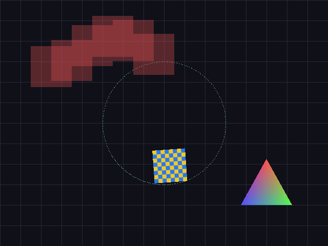

SDL3
====

Python 3 bindings for SDL3 (with SDL3_image).

``example/draw.py`` (regenerate with ``python3 example/draw.py docs/screenshot.png``).

Debian / Ubuntu
---------------
	* apt install libsdl3-dev libsdl3-image-dev

  (SDL3 packages are available from Debian Trixie / Ubuntu 24.10 onward.)

macOS
-----
	* brew install sdl3 sdl3_image
